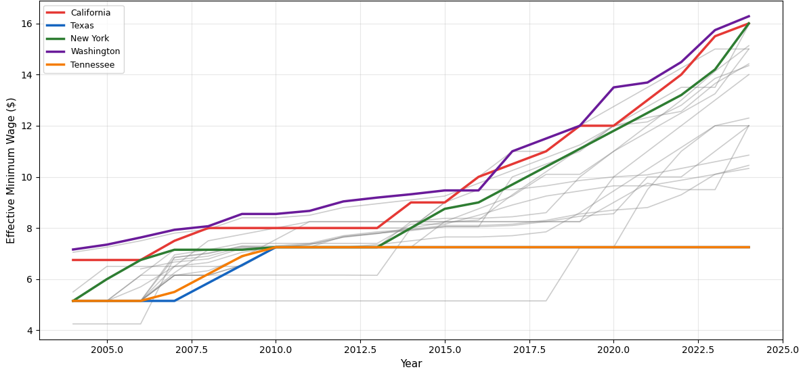
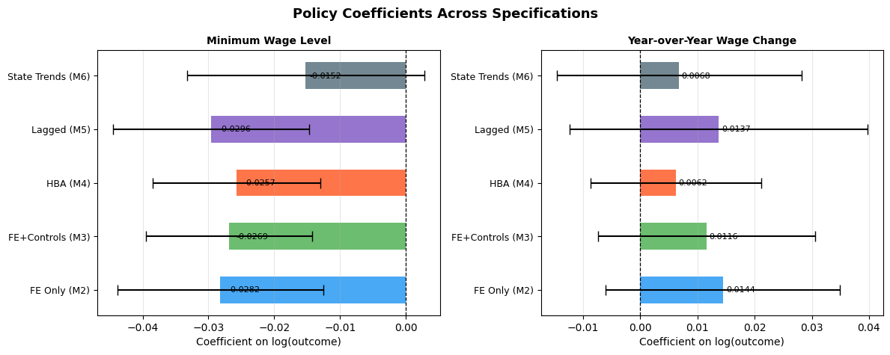
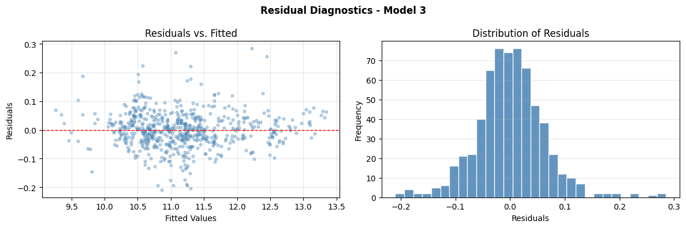

# Minimum Wage Policy and Business Formation: Evidence from U.S. State-Level Data

📄 [Read the full paper](minimum_wage_business_formation.pdf) · 📓 [Analysis notebook](panel_regression_analysis.ipynb)

**Author:** Habib Gul Ahmadzai | **Date:** May 2026

## 1. Abstract

This study evaluates whether there is a relationship between state-level minimum wage policy and business formation in the United States. The sample consists of 30 states from 2004 to 2024 (N = 624 state-year observations). Two-way fixed effects regressions are used with state and year fixed effects, and standard errors are clustered at the state level with small-sample corrections given the relatively small number of clusters.

The measure of business formation is total business applications from the U.S. Census Bureau's Business Formation Statistics, obtained via Federal Reserve Economic Data (FRED). The preferred model incorporates real GDP, unemployment rate, personal income per capita, and population as controls.

**Key findings:** A $1 increase in the state minimum wage is associated with a 2.7% reduction in total business applications, holding other variables constant (p < .001). The annual minimum wage change variable is positive but not statistically significant. After accounting for state-specific linear trends, the estimate shrinks to about 1.5%, becoming only marginally significant — suggesting part of the identifying variation is correlated with slow-moving state trends. A placebo test using future wage increases yields an estimate that is only marginally significant (p = .071). The results are broadly consistent with a deterrence effect operating through the labor cost channel.

**Keywords:** Business Formation, Minimum Wage, Fixed Effects, Entrepreneurship, Panel Data, Robustness

## 2. Key Figures

### Figure 2: Minimum Wage Trends Across 30 States (2004–2024)

States diverged sharply in policy after 2014. California, Washington, New York, and Oregon pushed minimum wages well above the federal floor, while Tennessee, Alabama, Louisiana, and South Carolina (shown in orange/gray) stayed anchored to it throughout. This split is what gives the fixed-effects model its identifying variation.

### Figure 4: Policy Coefficient Estimates Across All Specifications

A $1 increase in the state minimum wage is associated with a 2.7% reduction in total business applications (p < .001). This result holds up — in sign and in similar magnitude — across every specification tested: fixed effects alone, fixed effects with economic controls, a high-propensity applications robustness check, a lagged-policy version, and a model with state-specific linear trends.

### Figure 6: Residual Diagnostics for the Preferred Model

The preferred model's residuals show no systematic curve or funnel shape, and are approximately normally distributed — evidence against severe nonlinearity or heteroskedasticity in the main specification.

## 3. Contents of the Paper

- **Introduction & Literature Review** — employment effects debate, firm entry/exit and profitability, the demand-stimulus channel
- **Data** — sample, sources, variable construction, descriptive statistics
- **Econometric Model** — main specification, identification strategy, clustered standard errors
- **Results & Diagnostics** — primary regression results, robustness specifications, placebo test for reverse causality, model fit
- **Interpretation & Policy Implications** — appropriate causal language, limitations, future research directions

## 4. Data Sources

- **U.S. Census Bureau Business Formation Statistics** (total business applications), via FRED
- **FRED (Federal Reserve Economic Data)** — state minimum wage, real GDP, unemployment rate, per capita personal income, population

## 5. Methodology

- Two-way fixed effects (state + year) panel regression
- Standard errors clustered by state with small-sample corrections (30 clusters)
- Robustness checks: high-propensity business applications, lagged policy specification, state-specific linear trends, placebo/future-wage test for reverse causality

## 6. Running the Analysis

1. Open `panel_regression_analysis.ipynb` in Google Colab or Jupyter.
2. Add your own FRED API key in the designated cell ([get a free key here](https://fred.stlouisfed.org/docs/api/api_key.html)).
3. Run all cells — this downloads the panel data, runs the regression models, and generates the figures referenced in the paper.

## 7. Tools Used

Google Colab (Python), Grammarly, Google Scholar, JSTOR, Zotero
